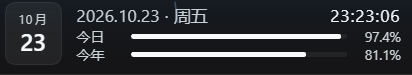
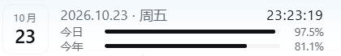

# 日晷 · Sundial

> 输入框下方的一条日期进度：今天过了多少，今年过了多少。

A tiny ambient date-progress strip for the DeepSeek Harness Web UI.

| 暗色主题 | 亮色主题 |
| :---: | :---: |
|  |  |

它刻意只做一件事：把「今天/今年过去了多少」放在输入框下面。没有设置页、没有通知、没有网络请求；所有颜色走主题 token，所以亮暗主题自动适配。

## 它显示什么

- 左侧日历块：月份 + 日期
- 右上实时时钟：`时:分:秒`
- 今日进度、今年进度，各一位小数
- 悬停显示：今日剩余 `h:mm`、今年剩余天数
- 中英文跟随 DSH 语言，切换语言即时重绘

## 体量

| 指标 | 数值 |
| --- | --- |
| 客户端脚本 | 9.4 KB |
| 运行时代码（不含截图） | 约 11 KB |
| `client.js` gzip 后 | 约 2.9 KB |
| 运行时 DOM 元素 | 18 个 |
| 定时器 | 1 个，1 Hz |
| 网络请求 / 会话写入 / 持久化存储 | 0 / 0 / 0 |
| 运行时依赖 | 0 |
| 常驻内存 | 未单独测量；与宿主共享 JS 堆，结构上只有一个组件实例和 18 个元素节点，估算 < 1 MB |

作为参照：README 里两张截图合计 16 KB，比插件本身还大一点。

它每秒只做一次 `Date` 差值计算和一次小组件重绘，不发送网络请求、不读取会话内容、不写会话日志、不调用模型，因此**不消耗任何模型 API token**。这里的 token 指主题 design token，和计费 token 是两回事。

## 安装

当前是一个本地作用域的 bundle（`@local/dsh-date-sundial`），未发布到 npm。npm 是 JavaScript 的公共包仓库；发布后 `install_bundle` 可以按包名直接安装，现在则需要先拿到源码。安装位置由 DSH 管理（当前 profile 的 `node_modules`），不需要手动拷贝到 DSH 安装目录。

1. 克隆仓库：

   ```bash
   git clone git@github.com:evanP-d/dsh-date-sundial.git
   ```

   不想用 git 的话，也可以在 GitHub 页面点「Code → Download ZIP」，解压后使用解压目录。

2. 把克隆目录的绝对路径交给你的 DSH agent，让它安装：

   ```text
   请用 plugin_manager 的 install_bundle，把 <克隆目录的绝对路径> 安装到当前 profile。
   ```

   不要手动改 profile 的 `package.json` 或 `cordis.patch.yml`，`install_bundle` 会处理安装和启用。

   > 本地安装会把插件链接到当前 profile 的 `node_modules`，源目录就是安装源。请把仓库放在一个稳定位置；安装后不要删除或移动它，否则插件会失效。移动后重新执行一次安装即可。

3. 刷新 DSH 页面，输入框下方就会出现。

卸载：在「设置 → 插件」里停用或移除「日晷」，或者让你的 agent 执行：

```text
plugin_manager remove_bundle target=@local/dsh-date-sundial
```

更新：在克隆目录 `git pull`，然后重启 DSH。如果目录被移动过，先重新执行一次安装。

## 兼容性

- 在 DSH Desktop / Web UI（2026-10）上测试通过。
- 依赖 `conversation.composer.dock` slot、`--dsw-alias-*` 主题 token 和 Client locale 服务；DSH 大版本升级后如果 slot 名或接口变化，可能失效。
- 非官方插件，与 DeepSeek 无隶属关系。

## 其他功能

想要自定义目标日倒计时、是否显示秒、紧凑模式？

自己叫自己的大肥鱼改。

## 设计约束

它之所以长这样，是因为守住了几个约束：

- 左边固定 38×42 的日历块，右边刚好两行；
- 只有一种强调色 `--dsw-alias-brand-primary`，其余全是次要文字色；
- 数字等宽、右对齐，秒在跳但版面不动。

在这上面继续叠行或叠开关，很快就会变挤。所以这个仓库只提供一种默认样子，把「还能怎么改」留给愿意动手的人。

## 开发

没有构建步骤，`client.js` 就是浏览器直接加载的模块。

```bash
node --check client.js
node --check index.js
node -e "JSON.parse(require('fs').readFileSync('package.json','utf8'))"
```

文件结构：

```text
date-sundial/
├── client.js         # 全部 UI、计时和 locale 注册
├── index.js          # 空的 Host 半
├── cordis.patch.yml  # bundle 插入行
├── locale/           # 插件管理器里的中英文标题/描述
│   ├── en.json
│   └── zh.json
├── icon.svg
├── assets/           # README 截图
└── package.json
```

## License

MIT。见 [LICENSE](LICENSE)。
